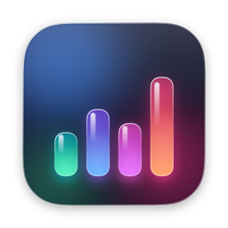
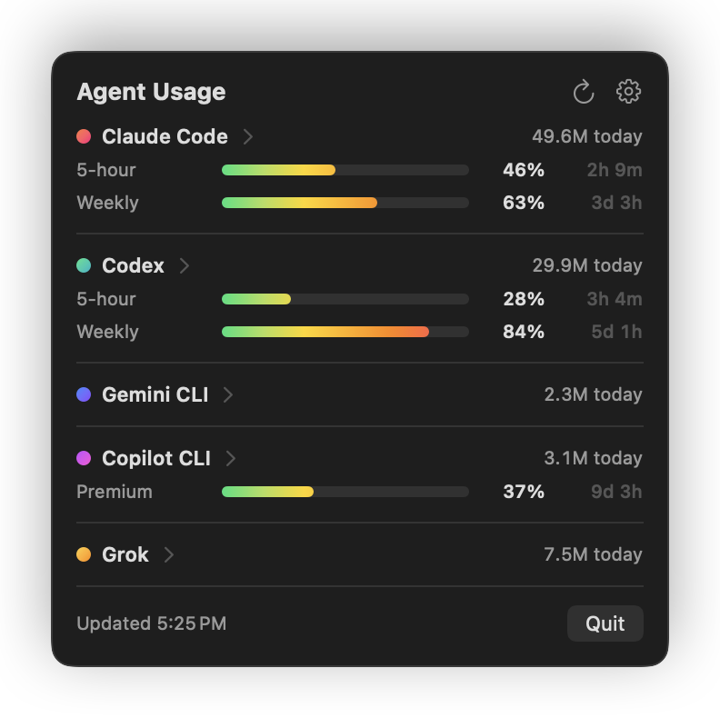
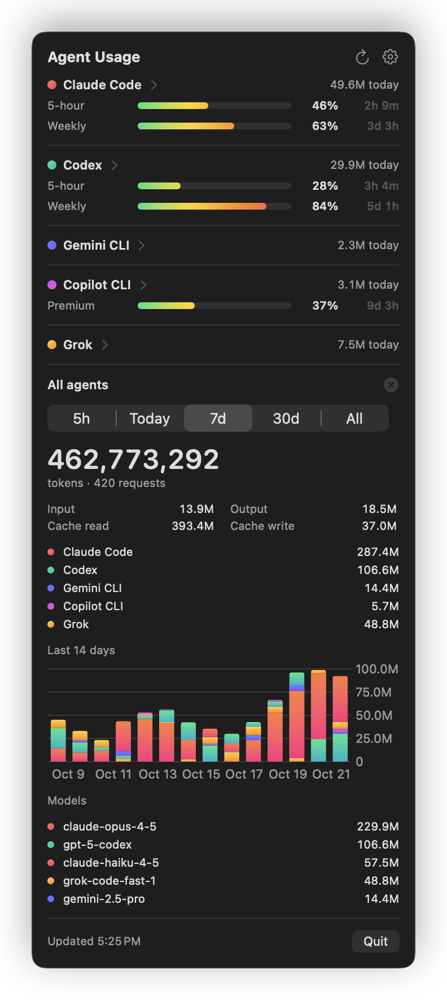
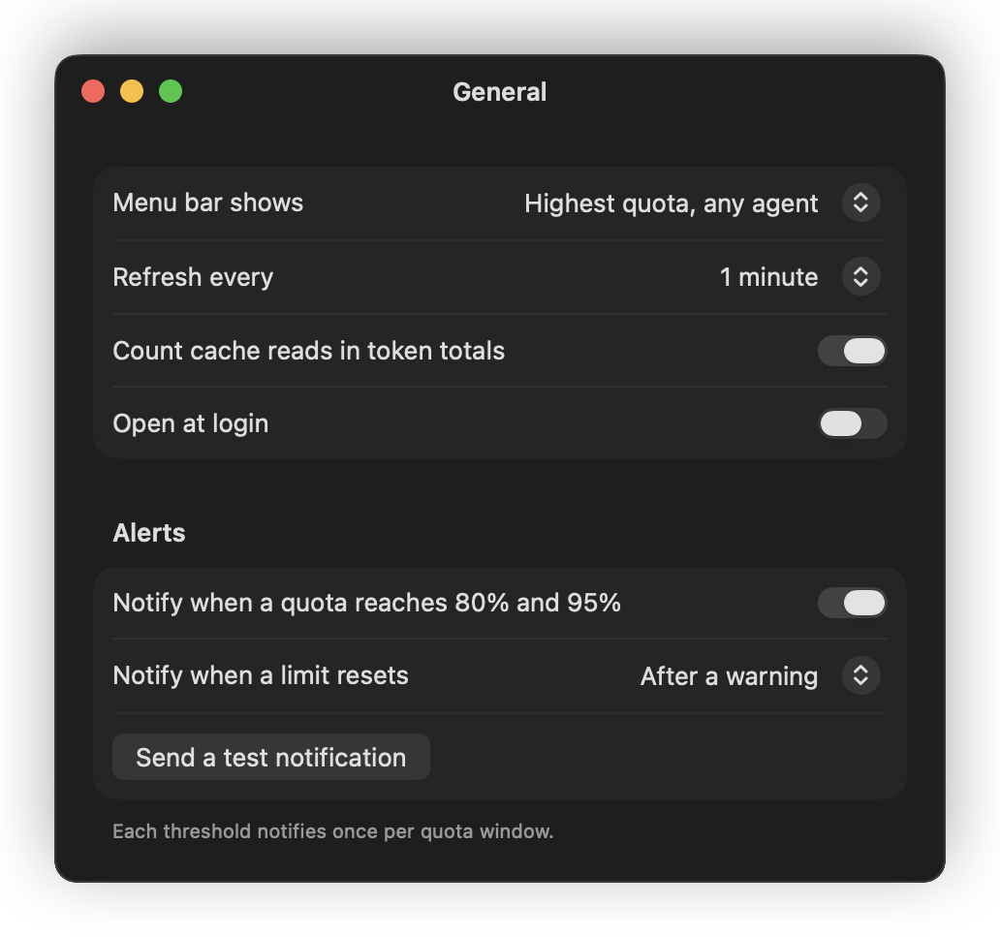
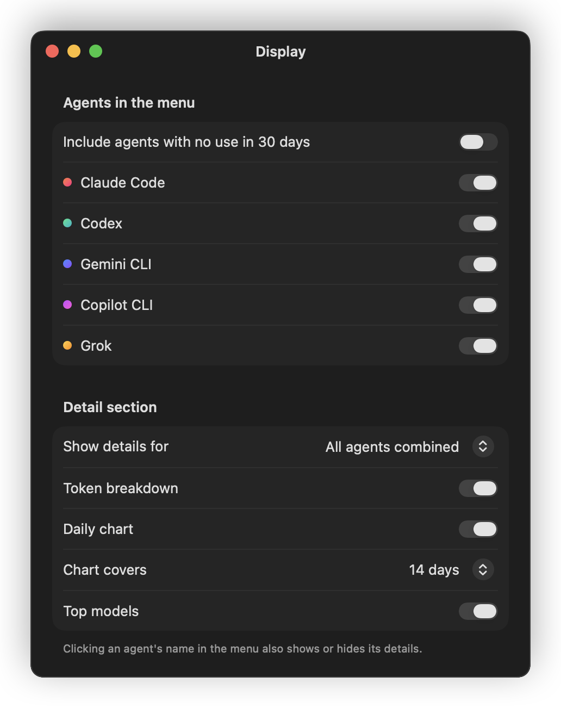
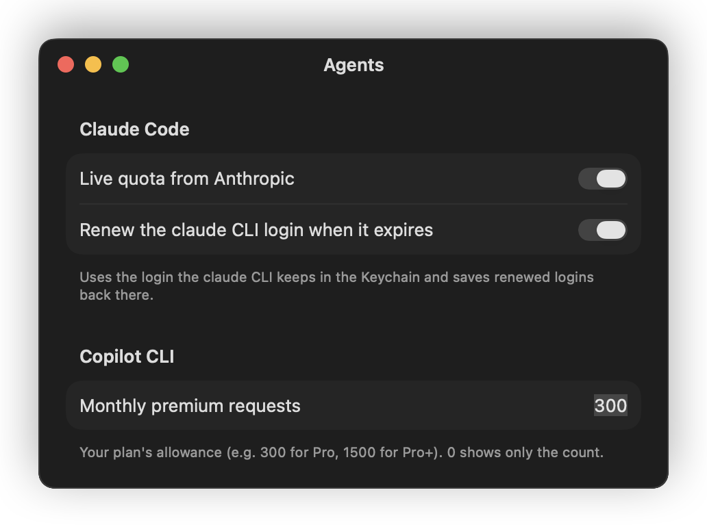

<p align="center">
  
</p>

<h1 align="center">Agent Usage</h1>

<p align="center">A macOS menu bar app that shows how much your AI coding agents are using: tokens, plan limits and alerts, in one place.</p>

---

## What it does

- **Usage at a glance:** a card per active agent with today's tokens and its plan limits as colour-coded bars that fill from green to red, with the time left until each one resets.
- **Plan limits (quota):** live 5-hour and weekly limits for Claude Code and Codex, and premium requests for GitHub Copilot.
- **Alerts:** a notification when a limit reaches 80% and 95%, and when it resets.
- **Details on demand:** click an agent's name to see totals for the last 5 hours, today, 7 days, 30 days or all time. The details include a token breakdown (input, output, cache), a daily chart and the most used models. You can also show all agents combined.
- **Your choice of menu bar text:** today's tokens, the highest limit across agents, one agent's limit, or just the icon.
- **Private by design:** it reads the agents' own log files on your Mac. Nothing is uploaded anywhere.

## Supported agents

| Agent | Token usage | Plan limits |
|---|---|---|
| Claude Code | yes | 5-hour and weekly (live) |
| OpenAI Codex | yes | 5-hour and weekly |
| GitHub Copilot CLI | yes | premium requests per month |
| Gemini CLI | yes | not available |
| Grok Build | yes | not available |

Agents appear automatically once they are installed and used. Agents that are idle for 30 days are hidden; you can show them again in Preferences.

## Screenshots

<p align="center">
  
  
</p>

<p align="center">
  
</p>

<p align="center">
  
  
</p>

<sub>Screenshots use made-up demo data.</sub>

## Requirements

**To run**
- macOS 14 Sonoma or later, on Apple silicon or Intel
- At least one of the supported agents installed

**To build**
- The Xcode Command Line Tools. The full Xcode app is **not** needed. To install them:

  ```bash
  xcode-select --install
  ```

## Installation

### From the disk image

1. Open `AgentUsage-1.0.dmg`.
2. Drag **AgentUsage** onto **Applications**.
3. The first time, right-click the app in Applications and choose **Open**, then confirm. This is needed once because the app is not notarized by Apple. If macOS still refuses, open System Settings → Privacy & Security and click **Open Anyway**.
4. The gauge icon appears in the menu bar. When macOS asks, allow notifications if you want quota alerts.
5. Optionally, turn on **Open at login** in Preferences.

The disk image runs on both Apple silicon and Intel Macs.

### From source

In Terminal, from this folder:

```bash
./build.sh install
```

This builds the app, copies it to the Applications folder in your home folder, and opens it. To only build, run `./build.sh`; the app is then in the `build` folder.

## Using it

- **Click the menu bar icon** to see your agents.
- **Click an agent's name** to show or hide its details below; the ✕ closes them.
- **The arrow button** refreshes now. Otherwise the app refreshes every minute (adjustable) and whenever you open the menu.
- **About** shows the version; **Quit** closes the app.
- **The gear button** opens Preferences:
  - **General:** menu bar text, refresh interval, whether cached tokens count in totals, open at login, alerts and a test notification.
  - **Display:** which agents appear, and what the detail section shows (breakdown, daily chart and its length, top models).
  - **Agents:** Claude live quota and login renewal, your Copilot plan's monthly premium-request allowance.

## Privacy

- Usage numbers come only from the log files each agent already keeps on your Mac.
- For Claude Code's live limits, the app asks Anthropic for your current usage, using the login the `claude` command-line tool stores in your macOS Keychain. When that login expires, the app renews it and saves it back, so the command-line tool stays signed in. Both can be switched off in **Preferences → Agents**. The app then shows the last limits Claude Code saved itself.
- Nothing else leaves your Mac. There is no analytics or tracking.

## Troubleshooting

- **An agent is missing:** it only appears after it has been used. Idle agents are hidden; turn on **Include agents with no use in 30 days** in Preferences → Display.
- **Claude's limits say the login has expired:** turn on **Renew the claude CLI login when it expires**, or run `claude` once in Terminal.
- **Copilot shows a count but no percentage:** enter your plan's allowance in Preferences → Agents (300 for Pro, 1500 for Pro+).
- **No notifications:** check System Settings → Notifications → Agent Usage, and use **Send a test notification** in Preferences.
- **The first numbers take a few seconds:** on launch, the app reads all existing logs once; later updates only read what's new.

## Uninstall

Quit the app from its menu (**Quit**), then move **AgentUsage** from Applications (or the Applications folder in your home folder, if you built it from source) to the Trash.
